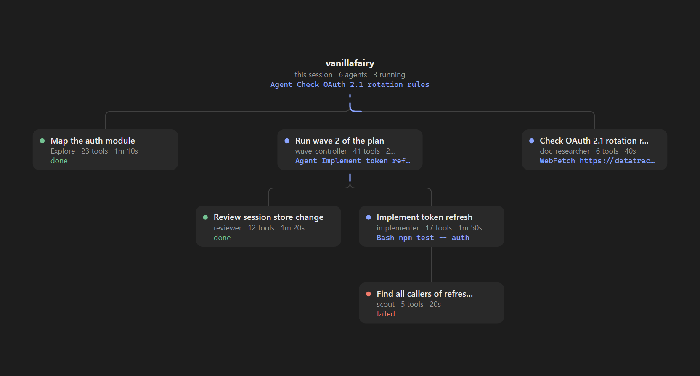

# agent-tree

## Summary

A Claude Code plugin that draws the current session's subagents as a live tree in a side pane. You can see who spawned whom and what each agent is doing right now, so you don't have to dig through the transcript to find out.

## Installation

You'll need a Claude Code build that supports function-hook plugins. I've tested it on 2.1.288.

Clone the repo:

```bash
git clone https://github.com/VanillaFairy/agent-tree.git
```

To try it in a single terminal session:

```bash
claude --plugin-dir /path/to/agent-tree
```

To have it in every session, desktop app included, add the folder to `CLAUDE_CODE_PLUGIN_DIRS` in the `env` block of `~/.claude/settings.json`:

```json
{
  "env": {
    "CLAUDE_CODE_PLUGIN_DIRS": "/path/to/agent-tree"
  }
}
```

If you load several plugin folders this way, separate them with `;` on Windows and `:` everywhere else.

## How to use

The pane opens on its own when a session starts, and each session shows its own tree, so switching sessions switches the tree too. If you've closed it, `/agent-tree` brings it back.



(The screenshot uses made-up sample data.)

The tree reads left to right. Your session sits in the first column, named after its project folder, the agents it spawned in the next, their own agents in the one after that, and so on. The dot shows where an agent is at: blue while it runs, green when it's done, red if it failed, grey if it was stopped. A running agent's card also shows the tool it's using right now, and a small pulse runs along the line into it.

The toolbar above the tree stays put:

- **−** and **+** zoom out and in, and **Fit** shows the whole tree.
- **◀ ▶ ▲ ▼** show up when the tree is bigger than the pane, and slide it a step at a time. A dimmed arrow means you're already at that edge.
- **Hide done** leaves out finished agents, except ones that still have something running under them. Press it again to bring them back.

On the desktop you can also drag the tree around. Drag with the middle or right mouse button and the tree follows the pointer. With the left button it works too, but the desktop holds the pane still while that button is down, so the tree jumps to where you let go.

The mouse wheel doesn't zoom or scroll the tree. The desktop only tells a plugin about the wheel when the pane itself scrolls, and this pane never does, so the toolbar can stay in place.

If you open a subagent's transcript, its card gets an outline so you can find it in the tree.

Colors follow your Claude Code theme, color-blind themes included. With `auto`, they follow your system's light or dark setting. In the terminal you get a plain text version of the tree.

## License

MIT. See [LICENSE](LICENSE).
